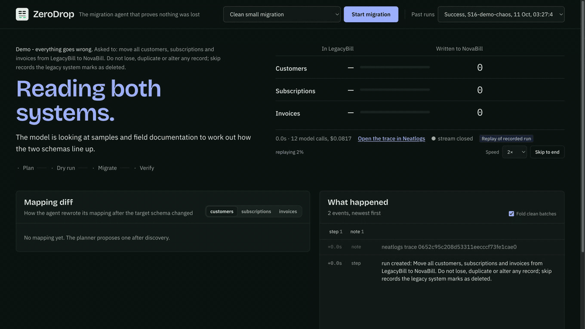
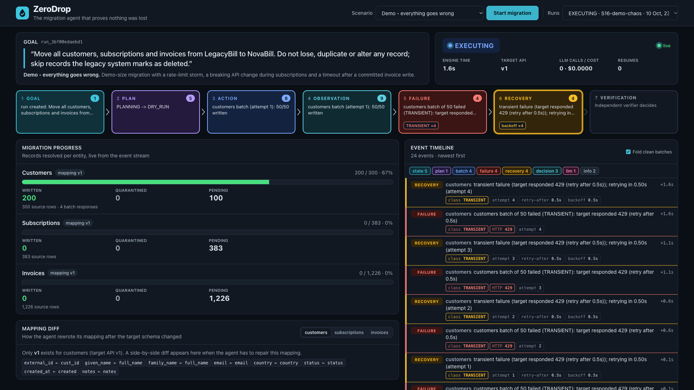
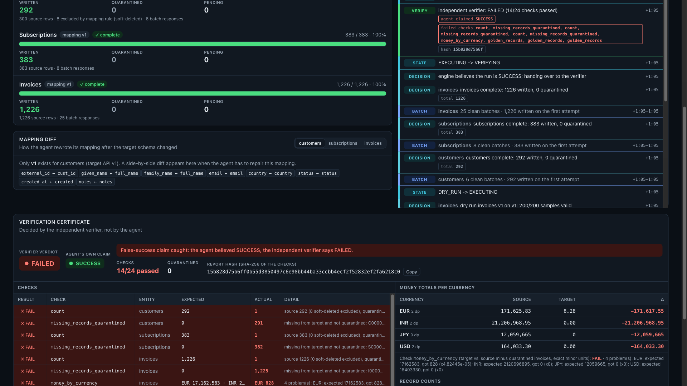

# ZeroDrop

**The migration agent that proves nothing was lost.**

Tell ZeroDrop "move all customers, subscriptions and invoices from LegacyBill to NovaBill".
It reads both systems, works out the field mapping, migrates in idempotent batches, recovers
from rate limits, timeouts, crashes and a breaking API change, and ends with a reconciliation
report from an independent verifier that the agent cannot influence.

> **The LLM decides, code executes, and an independent checker judges.**

**Try it:** https://eartherai.github.io/zerodrop/ (the dashboard replaying real recorded runs; press Start migration) ·
**Evidence page:** https://eartherai.github.io/zerodrop/evidence/ ·
**Video:** https://eartherai.github.io/zerodrop/video/zerodrop-demo.mp4 ·
**cfo.ai plan:** https://cfo.ai/s/VyrSUZBAxHyXEJfC

Built during neatHack 2026 by team Tokenmaxing. The dated build log, including what failed, is
in [`hackathon.md`](hackathon.md). **Judging? Start with [`EVIDENCE.md`](EVIDENCE.md):** one
page that maps each thing the rules ask for to a file, a run id or a trace.





**Demo video (2:37):** [`evidence/video/zerodrop-demo.mp4`](evidence/video/zerodrop-demo.mp4)

## Why
Every SaaS switch is a data migration, and migrations fail quietly: a batch dropped by a rate
limit, a duplicate after a timeout that hid a successful write, an API that changes version
halfway through. A migration that looks finished is not the same as one that is correct.

## How it works
| Step | Who | What |
|---|---|---|
| Understand both schemas, write the mapping | The model (bounded tool loop; Gemini in every run recorded here, Claude is the configured default) | A `MappingSpec` in a whitelisted mapping language: no arbitrary code from the model |
| Execute | Deterministic engine | Idempotent batches, SQLite ledger, checkpoint after every batch, crash and resume |
| Recover | Classifier, then the model only for contract changes | Wait on 429, look up before re-sending after a timeout, rewrite the mapping when the API changes |
| Judge | Independent verifier | Counts, duplicates, money per currency in minor units, references, every field against golden records |

The verifier imports nothing from the engine, the mapping language, the ledger or the agent.
When the engine believes SUCCESS and the verifier disagrees, that is recorded as a
**false success claim**. Details: [`ARCHITECTURE.md`](ARCHITECTURE.md).

## Results
Twenty seeded failure scenarios (`scenarios/scenarios.yaml`), each ending with the verifier.

| Evaluation | Matched expected verified outcome | False success claims |
|---|---|---|
| Baseline (`c4766e2`) | 19 of 20 | 0 |
| After fix 1: 429 waits are not failed attempts (`8c0a017`) | 20 of 20 | 0 |
| After fix 2: wait exactly `Retry-After` (`574aa2b`) | 20 of 20 | 0 |

These three runs use the **oracle planner**, a deterministic stand-in that always proposes the
correct mapping. They measure the engine, recovery and verifier, not the model.

**With a real model (Gemini planner):** all twenty scenarios have been run with a real model and
matched their expected verified outcome: clean and large-volume runs, rate limits, timeouts,
breaking API changes, crashes, orphans, duplicates, credential rotation and revocation, and
prompt injection in the data.

| Real-model pass | Commit | Matched | False success claims |
|---|---|---|---|
| `gemini-3.1-flash-lite`, pass 1 | `f858712` | 18 of 18 | 0 |
| `gemini-3.1-flash-lite`, pass 2 | `e65cc45` | 17 of 18 | 1, caught, fixed in `933a7a9` |
| `gemini-3.5-flash-lite` | `e65cc45` | 18 of 18 | 0 |
| `gemini-3.1-flash-lite`, pass 3 | `933a7a9` | 15 of 18 | 1, caught, fixed in `7b34f8c` |
| `gemini-3.1-flash-lite`, pass 4 | `7b34f8c` | 10 of the 10 that ran before the daily quota ended | 0 |
| **`gemini-3.5-flash-lite`, all 20 scenarios** | `1838455` | **20 of 20** | **0** |
| **`gemini-3.5-flash-lite`, all 20 scenarios** | `6c07c9f` | **20 of 20** | **0** |
| **`gemini-3.5-flash-lite`, all 20 scenarios, final code** | `d92588d` | **20 of 20** | **0** |
| **`gemini-3.1-flash-lite`, final code** (the model that made the mistakes) | `d92588d` | **18 of 18** | **0** |

The most useful results were the failures. Seven real-model runs ended with the engine
believing SUCCESS while the verifier reported FAILED: five where the model gave every record
the same id, two where it wrote yen amounts 100 times too large. **The independent verifier
caught all seven.** Each of the three causes was then reproduced as a failing test and closed
in the engine, so that mapping is now rejected before any write. Since Oct 12 the engine also
asks the independent verifier to re-read the first batch of every mapping, so a mistake the
dry run cannot see stops after one batch and the agent reports FAILED itself. One pass per
commit: this shows what happened, not a failure rate. Per-run tables, root causes, the run the agent never
repaired, and limits: [`EVALUATION.md`](EVALUATION.md).

When the agent's claim and the verifier disagree, the certificate says so. This is a real
model's run (`run_5d0171f3cddf`):



## Quick start
Docker:
```sh
docker compose up --build
# dashboard: http://127.0.0.1:8700   start "Demo - everything goes wrong"
```
Local:
```sh
uv sync
(cd ui && npm ci && npm run build)
uv run zerodrop serve                              # dashboard on http://127.0.0.1:8700
uv run zerodrop run S16-demo-chaos --planner oracle   # one run in the terminal
uv run zerodrop eval --planner oracle --label my-run  # all scenarios, results in evidence/eval/
uv run pytest -q
```
The oracle and naive planners need no keys and cost nothing. For a real model, copy
`.env.example` to `.env`, set `ZERODROP_GEMINI_KEY` (and `NEATLOGS_API_KEY` for traces) and
use `--planner gemini`: that is what every recorded run used. `--planner claude` with
`ZERODROP_ANTHROPIC_KEY` goes through the same interface but was never run (no credit).
Each run is capped in code: 30 model calls, $1.50, 15 minutes.

## Sponsor tools
**Neatlogs: the runtime record, and where incidents were raised and resolved.** Neatlogs'
own investigation agent went through our traces and raised three incidents; the critical one
("agent SUCCESS, evaluator FAILED") led to a code change and all three are resolved. Its AI
also suggested a false-success detector from our traces, which is now on. The whole story with
what it got right and wrong: [`EVIDENCE.md`](EVIDENCE.md), section 1. Each run is one trace. The root WORKFLOW span carries the
verdict (verifier status, the agent's own claim, false-success flag, checks, report hash).
Under it: AGENT spans for the planner and diagnoser, LLM spans from the wrapped model client
(tokens, cost, latency), TOOL spans per batch write, lookup and model tool call (with input
and result), a GUARDRAIL span per dry run (the gate before any write), a `recovery.<class>`
span per failure handled, a `state.<STATUS>` span per state change, and a scored EVALUATOR span
for the verifier. Every run stores its trace id, and the dashboard links to it. A before and after pair
of traces with compared numbers is in [`EVIDENCE.md`](EVIDENCE.md). Code:
`src/zerodrop/telemetry.py`.

**Entire: the build record.** Coding sessions are captured as checkpoints stored in git
(`refs/entire/checkpoints/*`) with secret and personal-data redaction configured in
`.entire/settings.json`. There is one checkpoint, covering the first part of the build;
later commits point to it. The **entire-graph**
code graph is installed for coding agents (`.entire/graph-agent.md`) and was used to locate
code and check the blast radius of a change before making it; saved output is in
`evidence/entire/`.

**cfo.ai: the business model.** Pricing per verified migration, costs, break-even and runway,
built from [`BUSINESS.md`](BUSINESS.md). Public view of the model: https://cfo.ai/s/VyrSUZBAxHyXEJfC

## Public demo mode
For an internet-facing deployment set `ZERODROP_PUBLIC_ENABLED=true`. Anyone can run the
oracle planner; real-model runs need the access code in `ZERODROP_PUBLIC_ACCESS_CODE`
(at least 16 characters) and stop at `ZERODROP_PUBLIC_SPEND_CAP_USD` (default 5) and
`ZERODROP_PUBLIC_MAX_RUNS_PER_HOUR` (default 12).

## About the test environment
LegacyBill and NovaBill are sandbox services written for this project, with real HTTP
behaviour: OpenAPI, bearer tokens, rate limits with `Retry-After`, idempotency keys, validation
and versioned schemas. Failures come from a seeded fault plan the agent never sees. All data
is synthetic.

## Docs
[`EVIDENCE.md`](EVIDENCE.md) · [`ARCHITECTURE.md`](ARCHITECTURE.md) · [`EVALUATION.md`](EVALUATION.md) ·
[`DEMO.md`](DEMO.md) · [`BUSINESS.md`](BUSINESS.md) ·
[`SUBMISSION.md`](SUBMISSION.md) · [`SUBMISSION_CHECKLIST.md`](SUBMISSION_CHECKLIST.md) · [`hackathon.md`](hackathon.md) ·
[`docs/PLAN.md`](docs/PLAN.md) · [`docs/CONTRACTS.md`](docs/CONTRACTS.md)
