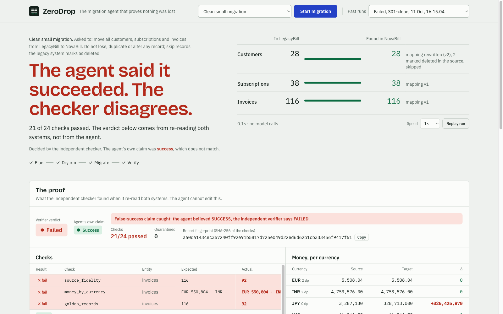

# ZeroDrop

**The migration agent that proves nothing was lost.**

Tell ZeroDrop "move all customers, subscriptions and invoices from LegacyBill to NovaBill".
It reads both systems, works out the field mapping, migrates in idempotent batches, recovers
from rate limits, timeouts, crashes and a breaking API change, and ends with a reconciliation
report from an independent verifier that the agent cannot influence.

> **The LLM decides, code executes, and an independent checker judges.**

Built during neatHack 2026 by team Tokenmaxing. The dated build log, including what failed, is
in [`hackathon.md`](hackathon.md).


**Demo video (2:35):** [`evidence/video/zerodrop-demo.mp4`](evidence/video/zerodrop-demo.mp4)

## Why
Every SaaS switch is a data migration, and migrations fail quietly: a batch dropped by a rate
limit, a duplicate after a timeout that hid a successful write, an API that changes version
halfway through. A migration that looks finished is not the same as one that is correct.

## How it works
| Step | Who | What |
|---|---|---|
| Understand both schemas, write the mapping | Claude (bounded tool loop) | A `MappingSpec` in a whitelisted mapping language: no arbitrary code from the model |
| Execute | Deterministic engine | Idempotent batches, SQLite ledger, checkpoint after every batch, crash and resume |
| Recover | Classifier, then Claude only for contract changes | Wait on 429, look up before re-sending after a timeout, rewrite the mapping when the API changes |
| Judge | Independent verifier | Counts, duplicates, money per currency in minor units, references, every field against golden records |

The verifier imports nothing from the engine, the mapping language, the ledger or the agent.
When the engine believes SUCCESS and the verifier disagrees, that is recorded as a
**false success claim**. Details: [`ARCHITECTURE.md`](ARCHITECTURE.md).

## Results
Twenty seeded failure scenarios (`scenarios/scenarios.yaml`), each ending with the verifier.

| Evaluation | Matched expected verified outcome | False success claims |
|---|---|---|
| Baseline (`c4766e2`) | 19 of 20 | 0 |
| After fix 1: 429 waits are not failed attempts (`8c0a017`) | 20 of 20 | 0 |
| After fix 2: wait exactly `Retry-After` (`574aa2b`) | 20 of 20 | 0 |

These three runs use the **oracle planner**, a deterministic stand-in that always proposes the
correct mapping. They measure the engine, recovery and verifier, not the model. With a
deliberately flawed planner the engine claims SUCCESS and the verifier reports FAILED (yen
totals 100 times too large).

**With a real model (Gemini planner):** all twenty scenarios have been run with a real model and
matched their expected verified outcome (one run each, five Flash-class models): clean and
large-volume runs, rate limits, timeouts, breaking API changes, crashes, orphans, duplicates,
credential rotation and revocation, and prompt injection in the data.

The most useful result was a failure. With the smallest model, five runs ended with the engine
believing SUCCESS while the verifier reported FAILED: the model had given every record the same
id, so the target kept one record per entity. The independent verifier caught all five. We then
taught the dry run to reject that mapping before any write, and the same five scenarios passed
on the same model. Per-run table, root cause, limits and files:
[`EVALUATION.md`](EVALUATION.md), `evidence/runs/`.

When the agent's claim and the verifier disagree, the certificate says so:



## Quick start
Docker:
```sh
docker compose up --build
# dashboard: http://127.0.0.1:8700   start "Demo - everything goes wrong"
```
Local:
```sh
uv sync
(cd ui && npm ci && npm run build)
uv run zerodrop serve                              # dashboard on http://127.0.0.1:8700
uv run zerodrop run S16-demo-chaos --planner oracle   # one run in the terminal
uv run zerodrop eval --planner oracle --label my-run  # all scenarios, results in evidence/eval/
uv run pytest -q
```
The oracle and naive planners need no keys and cost nothing. For the real model, copy
`.env.example` to `.env` and set `ZERODROP_ANTHROPIC_KEY` (and `NEATLOGS_API_KEY` for traces),
then use `--planner claude`. For Gemini as the planner model instead, set `ZERODROP_GEMINI_KEY`
and use `--planner gemini`. Each run is capped in code: 30 model calls, $1.50, 15 minutes.

## Sponsor tools
**Neatlogs: the runtime record.** Each run is one trace. The root WORKFLOW span carries the
verdict (verifier status, the agent's own claim, false-success flag, checks, report hash).
Under it: AGENT spans for the planner and diagnoser, LLM spans from the wrapped Anthropic
client, TOOL spans per batch write and lookup, CHAIN spans per recovery decision, and an
EVALUATOR span for the verifier. Every run stores its trace id, and the dashboard shows it.
Code: `src/zerodrop/telemetry.py`.

**Entire: the build record.** Coding sessions are captured as checkpoints stored in git
(`refs/entire/checkpoints/*`) with secret and personal-data redaction configured in
`.entire/settings.json`. A commit leads to the session that produced it.

**cfo.ai: the business model.** Pricing per verified migration, costs, break-even and runway,
built from [`BUSINESS.md`](BUSINESS.md).

## Public demo mode
For an internet-facing deployment set `ZERODROP_PUBLIC_ENABLED=true`. Anyone can run the
oracle planner; real-model runs need the access code in `ZERODROP_PUBLIC_ACCESS_CODE`
(at least 16 characters) and stop at `ZERODROP_PUBLIC_SPEND_CAP_USD` (default 5) and
`ZERODROP_PUBLIC_MAX_RUNS_PER_HOUR` (default 12).

## About the test environment
LegacyBill and NovaBill are sandbox services written for this project, with real HTTP
behaviour: OpenAPI, bearer tokens, rate limits with `Retry-After`, idempotency keys, validation
and versioned schemas. Failures come from a seeded fault plan the agent never sees. All data
is synthetic.

## Docs
[`ARCHITECTURE.md`](ARCHITECTURE.md) · [`EVALUATION.md`](EVALUATION.md) ·
[`DEMO.md`](DEMO.md) · [`BUSINESS.md`](BUSINESS.md) ·
[`SUBMISSION_CHECKLIST.md`](SUBMISSION_CHECKLIST.md) · [`hackathon.md`](hackathon.md) ·
[`docs/PLAN.md`](docs/PLAN.md) · [`docs/CONTRACTS.md`](docs/CONTRACTS.md)
